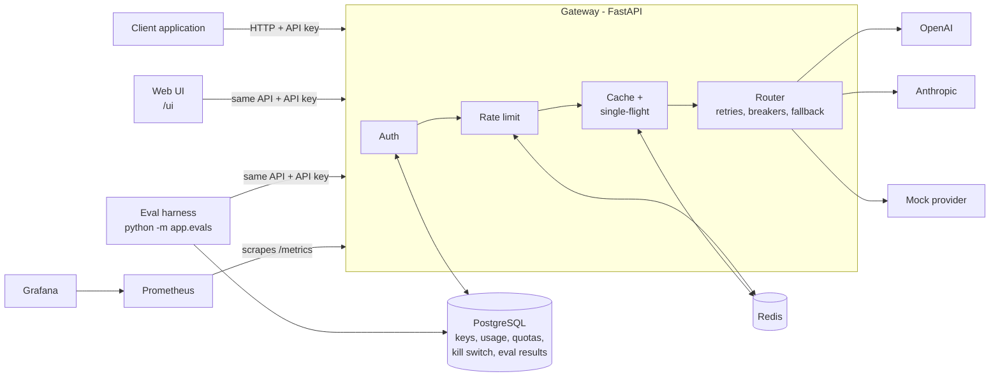
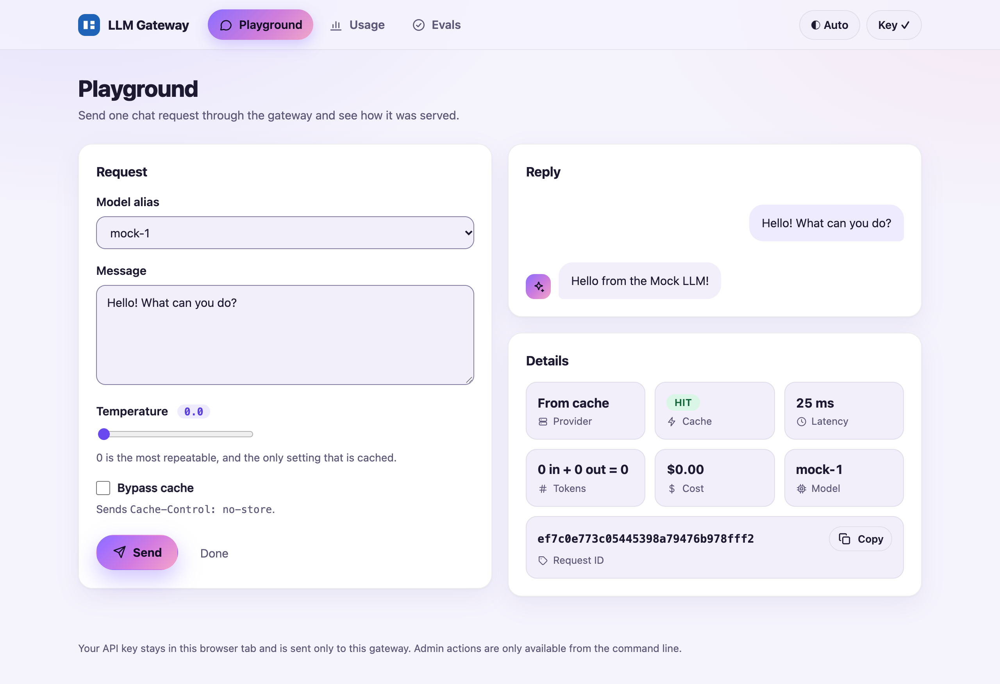

# LLM Gateway with Evaluation Harness

An HTTP service that sits between applications and LLM providers (OpenAI, Anthropic, and a built-in Mock). Every request goes through one API that checks the caller's key, enforces rate limits and quotas, reuses answers it has already paid for, falls back to another provider when one fails, and records what each request cost. It includes an evaluation harness that scores model answers through the same API, a small web UI, Prometheus metrics with a Grafana dashboard, and Terraform for running it on AWS.

**Highlights** (all measured; methods and caveats are in the linked docs)

- **Low overhead.** Through the full pipeline (key lookup in Postgres, rate limit in Redis, routing, usage write) a request to a zero-latency Mock took a median of 1.5 ms end to end, of which 1.2 ms was the gateway's own time. Real OpenAI and Anthropic calls took a median of 610 ms and 717 ms in a small sample, so the gateway was about 1% of a real request. [Benchmarks](docs/benchmarks.md)
- **Throughput.** One worker process handled 828–848 requests per second at 10 and 50 concurrent requests, with 0 errors (Docker Desktop on an M3 laptop, Mock provider; not a production figure).
- **Caching.** A cache hit took a median of 1.8 ms against 213.5 ms for a miss. On 1,000 requests with a realistic repeated-prompt mix, 84.5% were answered from the cache and the provider was called 155 times; at `gpt-4.1-mini` prices (simulated tokens) the bill went from $0.52 to $0.08.
- **Single-flight.** 50 identical requests arriving at once made 1 provider call (50 with the cache bypassed), in each of three runs.
- **Failover.** With the primary provider failing every call, 200 of 200 requests succeeded through the fallback. The circuit breaker opened after 5 failures, so the failing provider was called 5 times in total, and once it was open a fallback request took 1.7 ms against 1.6 ms on a healthy route.
- **Rate limiting.** Offered 50 requests per second for a minute against a limit of 120 per minute, the Redis token bucket allowed 239, against 240 expected from its formula.
- **Answer quality.** On the 27 starter eval cases, OpenAI `gpt-4.1-mini` passed 27 and Anthropic `claude-haiku-5-5` passed 26, for $0.0026; the harness's cost figures matched the gateway's billing records. CI runs an eval against the Mock on every push and fails below a 100% pass rate.
- **Tested.** 737 automated tests (685 run anywhere, 52 more against real Redis and PostgreSQL), 96% line and branch coverage of `app/`, with a 90% gate in CI.
- **Deployed to AWS.** Terraform (ECS Fargate, ALB, RDS PostgreSQL, optional Redis, no NAT Gateway, no secrets in state) was applied, smoke-tested and destroyed on the same day, with nothing left in the account afterwards; estimated at about $1.65 a day while running. [Deployment](docs/deploy.md)



| Web UI (Playground) | Grafana dashboard |
|---|---|
|  |  |

## Try it in 5 minutes

You need Docker. No provider keys are needed: the Mock provider answers.

```bash
git clone https://github.com/msaifkms/LLM-Gateway.git && cd LLM-Gateway
cp .env.example .env
docker compose up --build -d
docker compose run --rm gateway python -m app.db.migrate

docker compose run --rm gateway python -m app.cli create-user demo
docker compose run --rm gateway python -m app.cli issue-key demo   # prints the key once
export KEY=llmgw_...                                                # paste it here
```

1. Open http://localhost:8000/ui, paste the key, and send a message to `mock-1` in the Playground. Send it again at temperature 0 to see `X-Cache: HIT`.
2. Run an eval through the gateway, then open the **Evals** page:

   ```bash
   EVAL_API_KEY=$KEY docker compose run --rm evals run --dataset mock_smoke --model mock-1
   ```

3. Or call the API directly:

   ```bash
   curl -s http://localhost:8000/v1/chat/completions -H "Authorization: Bearer $KEY" \
     -H "Content-Type: application/json" \
     -d '{"model":"mock-1","messages":[{"role":"user","content":"Hello!"}],"temperature":0}'
   ```

For metrics, start `docker compose --profile observability up -d` and open Grafana at http://localhost:3000. Stop everything with `docker compose --profile observability down`.

## Features

- One API (`POST /v1/chat/completions`) for OpenAI, Anthropic and a Mock provider with latency and failure injection
- Priority fallback, retries with backoff and jitter, per-provider circuit breakers, timeouts and a request deadline
- A per-user Redis response cache for temperature-0 requests (fail-open), with single-flight
- Hashed API keys, Redis token-bucket rate limits, daily token and USD quotas, and a kill switch
- Per-request cost tracking and a usage API (`GET /v1/usage`)
- JSON logs with request IDs, 20 Prometheus metrics and a Grafana dashboard generated from code
- An evaluation harness (`python -m app.evals`): JSONL datasets, rule-based scorers and an LLM judge, stored runs, regression comparison and a CI gate
- A web UI at `/ui`: Playground, Usage and Evals
- Terraform for AWS (ECS Fargate, ALB, RDS PostgreSQL, optional Redis) with deploy and admin-task scripts
- A benchmark suite (`python -m bench`) against the Mock provider

Not built yet: streaming responses, routes from a YAML file, distributed tracing ([docs/CLEANUP.md](docs/CLEANUP.md)). The full feature list, endpoints, headers, errors, configuration, metrics and admin commands are in **[docs/reference.md](docs/reference.md)**.

## Tech Stack

- **Backend:** Python, FastAPI, Uvicorn, Pydantic, HTTPX
- **Database:** PostgreSQL 16 (asyncpg)
- **Cache and rate limiting:** Redis 7 (redis-py asyncio)
- **Observability:** structured JSON logging, Prometheus, Grafana
- **Infrastructure:** Docker, Docker Compose, Terraform
- **Cloud:** AWS (ECS Fargate, ALB, RDS, ElastiCache, ECR, SSM Parameter Store, Secrets Manager, CloudWatch Logs, S3)
- **Testing:** pytest, pytest-cov, Ruff, mypy, tflint, shellcheck
- **Benchmarks:** asyncio + HTTPX load client, matplotlib charts
- **CI:** GitHub Actions (with Redis and Postgres services), pre-commit

## Project structure

```
app/
  api/          HTTP endpoints: chat, usage, models, eval results, metrics
  auth/         API keys (hashed), admin operations, SSM key hand-off
  core/         config, routes, router, cache, single-flight, rate limiter, kill switch, logs, metrics
  db/           connection pool and numbered SQL migrations
  evals/        evaluation harness: datasets, scorers, LLM judge, runner, reports, CLI
  providers/    OpenAI, Anthropic and Mock providers
  resilience/   error taxonomy, retries with backoff, circuit breaker
  usage/        prices, cost calculation, usage recording, quotas
  ui/           the web UI (static HTML, CSS and JavaScript)
  cli.py        admin CLI (users, keys, limits, kill switch)
  main.py       FastAPI app and startup wiring
bench/          benchmark suite (python -m bench)
infra/          Terraform for AWS, plus deploy and one-off task scripts
ops/            Prometheus config and the Grafana dashboard generator
tests/          unit, API, fault-injection and real Redis/Postgres tests
docs/           design, benchmarks, deployment, evals, cleanup notes, screenshots
```

## Documentation

| Document | What it covers |
|---|---|
| [docs/reference.md](docs/reference.md) | Endpoints, headers, errors, configuration, metrics, admin CLI, the eval harness, running the tests, and the full limitations list |
| [docs/benchmarks.md](docs/benchmarks.md) | Measured overhead, cache, single-flight, resilience and rate-limiter results, with the method and machine |
| [docs/design.md](docs/design.md) | Key design decisions and trade-offs, in short ADR form |
| [docs/deploy.md](docs/deploy.md) | AWS deployment with Terraform, step by step, with costs and teardown |
| [docs/evals/README.md](docs/evals/README.md) | Dataset format, every scorer, and sample eval reports |
| [docs/CLEANUP.md](docs/CLEANUP.md) | What has been tidied up, and what is deliberately left for later |
| [bench/README.md](bench/README.md) | How the benchmark suite works |

## Project status

**Version 1.0.0: all eight phases are complete** ([progress](docs/reference.md#development-progress)).

Phases 1 to 5 built the gateway: one API for several providers, retries, circuit breakers and fallback, a per-user cache with single-flight, keys, rate limits, quotas, cost tracking, a kill switch, logs and metrics. Phase 6 added the evaluation harness, which scores answers through the gateway's own API and gates CI. Phase 7 deployed it to AWS with Terraform, tested it there and tore it down; a web UI followed. Phase 8 measured it: [docs/benchmarks.md](docs/benchmarks.md) has the numbers, [docs/design.md](docs/design.md) the reasons behind the main decisions, and [docs/CLEANUP.md](docs/CLEANUP.md) what is deliberately left for later.

The main limitations: only non-streaming text chat is supported; breaker and single-flight state are per process; quotas are soft (one request or burst can overshoot); rate limits need Redis; and the AWS setup serves HTTP unless a certificate is configured. The [full list](docs/reference.md#limitations) has 20 items.

This is a portfolio project. It has been tested locally, in CI and in one short AWS deployment, but it has not served production traffic.

## License

MIT
