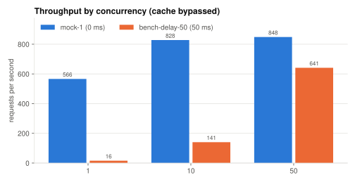
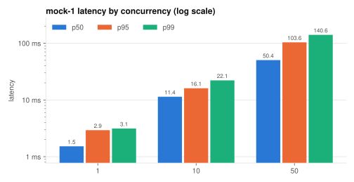
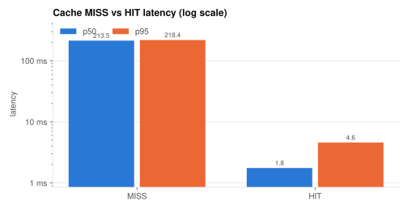
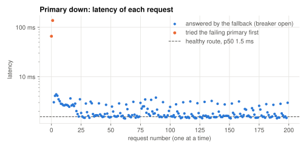
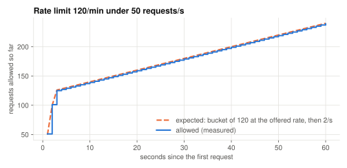

# Benchmarks

These numbers come from the gateway running in **Docker Compose on one laptop**, with the **Mock provider** standing in for OpenAI and Anthropic. They show what the gateway itself costs and what its cache, single-flight, fallback, circuit breaker and rate limiter do, measured end to end. They are **not production numbers**: the client, the gateway, Postgres and Redis share one Docker VM, there is no real network, and no real model is called. Every figure below was measured by `python -m bench`; the raw results are in [benchmarks/results.json](benchmarks/results.json).

## Setup

|  |  |
|---|---|
| Machine | Mac15,12 (Apple M3, 8 cores, 16 GiB), Darwin 15.6.1 |
| Docker | Docker Desktop 29.9.2, VM with 8 CPUs and 7.7 GiB; Compose 5.6.1 |
| Gateway | Python 3.12.16, one Uvicorn worker, the project's Dockerfile and default settings (Postgres pool of 10, JSON logs at INFO) |
| Data stores | postgres:16 and redis:7-alpine from docker-compose.yml |
| Power | on battery (not plugged in) |
| Client | Python asyncio + HTTPX in a container on the Compose network (`http://gateway:8000`) |
| Runs | 3 runs of every scenario, each on a freshly restarted gateway, after 50 warm-up requests; tables show the median across runs |
| Measured | 2026-11-21T03:19:46+00:00 at commit `0c227d9` |
| Sleep during scenarios | none: the largest gap between wall clock and perf_counter in any scenario was 0.0 s (over 2 s would invalidate the run) |

**Method.** Each scenario runs 3 times. The scenarios are interleaved (run 1 of everything, then run 2, ...) so slow drift on the machine does not favour one of them, and the gateway is restarted before each scenario, so breakers, single-flight and in-process metrics start clean. Latency is wall-clock time measured by the client around each request. The gateway's own Prometheus metrics give the server-side numbers and count provider calls, so the gateway's share and the provider's share are separated by measurement, not inference. Costs use the gateway's real price table on simulated token counts (the Mock is free). The runner keeps macOS awake and records, for every scenario, whether the machine slept during it (wall clock against `perf_counter`); the largest gap in this run is shown in the setup table.

**Benchmark-only routes.** With `GATEWAY_BENCH_MODE=true` (only in `bench/docker-compose.bench.yml`) the gateway adds three Mock targets: one that waits a fixed 50 ms, one that always fails with a server error, and one that waits 200 ms and reports 500 + 200 tokens of `gpt-4.1-mini`, so cache savings have a dollar value. Routes: `bench-delay-50`, `bench-fallback` (failing primary, then the healthy `mock-1`) and `bench-priced`.

## Why the client runs inside Docker

`GET /healthz` touches no database and no Redis, so it measures the HTTP path alone. Sent from the Mac through Docker Desktop's published port, it is slower than the same requests sent from a container on the Compose network:

| Concurrency | Host: req/s | Host: p50 | Host: p99 | In-network: req/s | In-network: p50 | In-network: p99 |
|---|---:|---:|---:|---:|---:|---:|
| 1 | 833 | 1.1 ms | 3.0 ms | 1,469 | 0.6 ms | 1.7 ms |
| 10 | 2,355 | 4.1 ms | 7.4 ms | 2,854 | 3.2 ms | 6.6 ms |
| 50 | 2,474 | 19.5 ms | 37.5 ms | 2,995 | 15.9 ms | 31.0 ms |

One at a time, the median through the published port was 1.9× the in-network median; at 50 concurrent requests, throughput was 17% lower and p99 21% higher. That port forwarding between macOS and the Docker VM is not part of the gateway, so every scenario below runs its client inside the Compose network. Load at 10 and 50 concurrent requests is split across 5 client processes, because in trial runs a single Python client process became the bottleneck before the gateway did.

## 1. Gateway overhead

Every request goes through the whole pipeline, exactly like real traffic: the API key is looked up in Postgres, the rate limiter runs in Redis, the router calls the Mock, and a usage row is written to Postgres. The cache is bypassed (`Cache-Control: no-store`, temperature 0.7), so every request reaches the provider. "Gateway's own time" is the gateway's request-handler time minus the provider-call time, both from its own histograms.

| Route | Concurrency | p50 | p95 | p99 | Req/s | Gateway's own time (mean) | Errors |
|---|---:|---:|---:|---:|---:|---:|---:|
| `mock-1` | 1 | 1.5 ms | 2.9 ms | 3.1 ms | 566 | 1.2 ms | 0 |
| `mock-1` | 10 | 11.4 ms | 16.1 ms | 22.1 ms | 828 | 10.4 ms | 0 |
| `mock-1` | 50 | 50.4 ms | 103.6 ms | 140.6 ms | 848 | 54.9 ms | 0 |
| `bench-delay-50` | 1 | 63.3 ms | 67.8 ms | 70.2 ms | 16 | 7.6 ms | 0 |
| `bench-delay-50` | 10 | 71.3 ms | 76.9 ms | 80.7 ms | 141 | 14.7 ms | 0 |
| `bench-delay-50` | 50 | 78.5 ms | 95.7 ms | 106.4 ms | 641 | 23.9 ms | 0 |

**Added latency, isolated.** With a provider that takes a fixed 50 ms, everything above 50 ms is the gateway, the HTTP hop, and any overrun of the Mock's own sleep (last column):

| `bench-delay-50`, one request at a time | Added p50 | Added p95 | Added p99 | Gateway's own time (mean) | Mock's 50 ms sleep took (mean) |
|---|---:|---:|---:|---:|---:|
| Idle between requests | 13.3 ms | 17.8 ms | 20.2 ms | 7.6 ms | 52.9 ms |
| Machine kept busy (light background load) | 5.5 ms | 9.1 ms | 10.4 ms | 3.9 ms | 51.0 ms |





**What this shows.** One request at a time, the full pipeline (Postgres lookup, Redis rate limit, routing, Postgres usage write, a JSON log line) takes a median of 1.5 ms end to end, of which about 1.2 ms is the gateway's own handler time; `/healthz` alone is 0.6 ms. Against a provider that takes 50 ms, the gateway added a median of 5.5 ms when the machine was busy, and 13.3 ms when it sat idle between requests. That gap is the laptop's VM waking up, not gateway work: the gateway's own time and even the Mock's 50 ms sleep both stretch when every container goes idle between requests, and shrink back with a little background load. Real model calls take hundreds of milliseconds to seconds, so a few milliseconds of gateway time is a small fraction of a request. Throughput peaked at 848 requests per second at concurrency 50 on one Uvicorn worker. From 10 to 50 concurrent requests, throughput went from 828 to 848 requests per second, and p99 latency reached 140.6 ms. At that point requests queue: inside the handler as well as in front of it. More workers or instances would raise the ceiling, at the cost of making in-process state (breakers, single-flight) per process; see [CLEANUP.md](CLEANUP.md).

## 2. Cache

The same 100 prompts are sent twice, one at a time, at temperature 0 on `bench-priced` (a Mock that takes 200 ms). The first pass misses; the second is served from Redis.

|  | p50 | p95 | p99 | Requests per run |
|---|---:|---:|---:|---:|
| MISS (calls the 200 ms Mock) | 213.5 ms | 218.4 ms | 219.1 ms | 100 |
| HIT (answered from Redis) | 1.8 ms | 4.6 ms | 7.9 ms | 100 |

Then a realistic mix: 1,000 requests drawn from 200 prompts with a Zipf distribution (a few prompts are very common, most are rare), 10 in flight at a time, each run with fresh prompts.

| Repeated-prompt mix, 10 concurrent | Median of runs |
|---|---:|
| Requests | 1,000 |
| Distinct prompts | 155 (Zipf-distributed over 200) |
| Answered from cache (HIT + COALESCED) | 84.5% |
| Cache statuses (run 1) | COALESCED 13, HIT 832, MISS 155 |
| Provider calls | 155 (instead of 1,000) |
| Cost without a cache | $0.5200 |
| Cost billed | $0.0806 |
| Saved (the gateway's `gateway_cost_saved_usd_total`) | $0.4394 |
| Errors | 0 |



**What this shows.** A cache hit took a median of 1.8 ms against 213.5 ms for a miss, because a hit never reaches the provider. In the repeated-prompt mix, 84.5% of requests were answered without a provider call, and the gateway made 155 provider calls for 1,000 requests. At `gpt-4.1-mini` list prices on the simulated token counts, that cut the bill from $0.5200 to $0.0806, and the gateway's own savings counter recorded the same $0.4394. The saving depends entirely on how repetitive the traffic is; only temperature-0 requests are cached.

## 3. Single-flight

50 identical, cacheable requests are sent at the same moment to `bench-priced` (200 ms), so they all arrive before the first answer exists. Then the same with the cache bypassed.

| 50 identical requests at once | Provider calls (range) | Statuses (run 1) | p50 | Slowest | Billed |
|---|---:|---|---:|---:|---:|
| Cache on (single-flight) | 1 (1–1) | COALESCED 49, MISS 1 | 232.0 ms | 245.1 ms | $0.0005 |
| Cache bypassed (`no-store`) | 50 (50–50) | BYPASS 50 | 288.6 ms | 335.0 ms | $0.0260 |

**What this shows.** With the cache on, 50 simultaneous identical requests made 1 provider call: one request (MISS) called the provider and the others (COALESCED) waited for its answer, and only the leader was billed. With the cache bypassed, every request called the provider. Single-flight works within one gateway process; several instances would each make one call.

## 4. Resilience: primary down

`bench-fallback` lists a Mock that fails every call (a server error, which is retryable) and then the healthy `mock-1`. Each attempt on a target is retried up to 2 times with jittered backoff, and a target's circuit breaker opens after 5 consecutive failures, for 30 seconds. 200 requests are sent one at a time, then 200 with 10 in flight, each on a freshly started gateway (breakers closed). For the first 20 sequential requests the gateway's metrics are read after every request, so it is known exactly which requests reached the failing primary.

| `bench-fallback`, primary always fails | One at a time | 10 in flight |
|---|---:|---:|
| Requests that succeeded | 200 of 200 (200–200) | 200 of 200 (200–200) |
| Calls that reached the failing primary | 5 (5–5) | 5 (5–5) |
| Requests that tried the primary first | 2 | – |
| Latency of those requests (p50) | 311.3 ms | – |
| Latency once the breaker was open (p50 / p99) | 1.7 ms / 4.7 ms | 10.4 ms / 109.9 ms (all requests) |
| Healthy route `mock-1`, same conditions (p50 / p99) | 1.6 ms / 3.6 ms | – |



**What this shows.** With the primary failing every call, 200 of 200 requests succeeded, all answered by the fallback. The failing primary was called 5 times in total: the first requests tried it (with retries and backoff) before falling back, which made them slow, then the breaker opened and every later request skipped the primary without calling it. Once the breaker was open, a fallback request took a median of 1.7 ms, against 1.6 ms on the healthy route directly, so skipping an open circuit costs almost nothing. With 10 requests in flight the outcome was the same. This confirms the Phase 2 claim (100 of 100 requests succeed with the primary fully down, and the failing provider is called 5 times) on a larger sample. The 30-second recovery probe is not exercised here, because each run finishes well within 30 seconds.

## 5. Rate limiter accuracy

A user with a limit of 120 requests per minute is sent 50 requests per second for 60 seconds, on a fixed schedule, so the offered load does not depend on how fast refusals come back. The token bucket holds 120 tokens and refills at 120/60 = 2 per second, so over a 60-second window it should allow its full bucket at once plus about 120 more.

| Limit 120 per minute | Median of runs (range) |
|---|---:|
| Requests offered | 3,000 (50/s for 60 s) |
| Allowed | 239 (239–239) |
| Expected from the bucket (limit + limit/60 × seconds) | 240.0 |
| Allowed in the first 3 s (the full bucket of 120, plus refill) | 125 |
| Sustained rate after the first 10 s | 120.1 per minute (limit 120) |
| Refused with 429 | 2,761, all with `Retry-After` |
| Other statuses | 0 |



**What this shows.** The limiter allowed 239 requests where the bucket's formula gives 240.0: the initial burst equal to the limit, then a steady 120.1 per minute, which matches the configured 120. Requests were sent at 50 per second from many concurrent tasks, and the atomic Lua script never let more through than the bucket held. So "120 per minute" means a burst of up to 120, then 120 per minute, not a hard cap of 120 in any 60-second window.

## Real providers, for scale

A small sample against the real APIs, through the same gateway on the same laptop, over the public internet: 10 uncached requests per route, one at a time, a short prompt, at most 40 output tokens. Measured 2026-11-21T03:30:13Z; the whole sample cost $0.000513. Raw data: [benchmarks/real_sample.json](benchmarks/real_sample.json).

| Route (model) | Succeeded | p50 | p95 | Provider call (mean) | Gateway's own time (mean) | Cost |
|---|---:|---:|---:|---:|---:|---:|
| `openai-default` (gpt-4.1-mini-2025-04-14) | 10 of 10 | 610.0 ms | 1.40 s | 781.5 ms | 9.4 ms | $0.000298 |
| `anthropic-default` (claude-haiku-5-5) | 10 of 10 | 716.9 ms | 2.06 s | 928.0 ms | 9.8 ms | $0.000215 |

**What this shows.** A real model call took hundreds of milliseconds, and the gateway's own time was 1.0%–1.2% of each request. That is why a few milliseconds of gateway overhead (section 1) does not matter much in practice. 10 requests per route is a small sample, from one place at one time: it shows the scale, it does not rank the providers.

## Reproduce

```bash
python -m pip install -r requirements-dev.txt
python -m bench                 # about 15 minutes: setup, 3 runs, this page and the charts
python -m bench --runs 1 --only cache,single_flight   # a quick subset
python -m bench report          # rebuild this page from docs/benchmarks/results.json
```

It needs Docker, and uses the normal Compose stack plus `bench/docker-compose.bench.yml`. It creates its own users and keys, and costs nothing. On a laptop, keep it plugged in and awake. [bench/README.md](../bench/README.md) describes each scenario.
