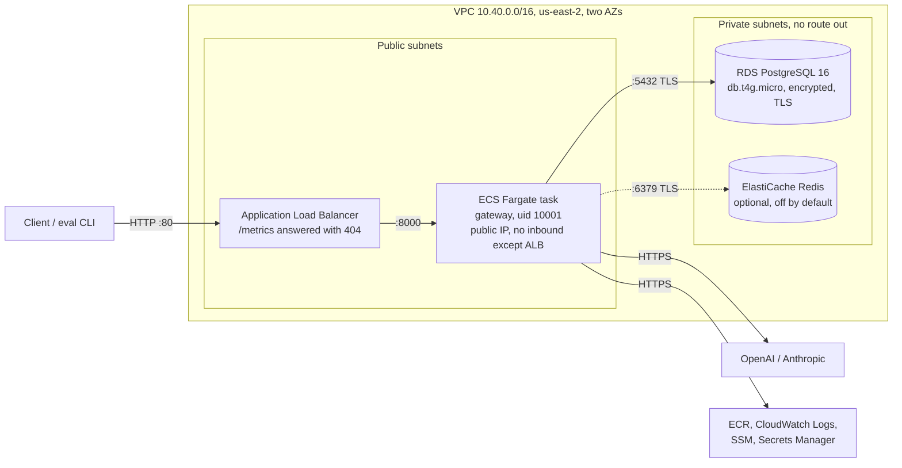

# Deploying to AWS

This guide runs the gateway on AWS with ECS Fargate, an Application Load Balancer and RDS PostgreSQL. All of it is defined in Terraform in [`infra/`](../infra/), in `us-east-2`. It is built to be cheap and to come down completely: deploy, test, take screenshots, and destroy on the same day for well under a dollar.



## Contents

- [How deploys work (and why they are manual)](#how-deploys-work-and-why-they-are-manual)
- [Design decisions](#design-decisions)
- [Prerequisites](#prerequisites)
- [1. Bootstrap the state bucket](#1-bootstrap-the-state-bucket)
- [2. Configure, plan and apply](#2-configure-plan-and-apply)
- [3. Provider API keys (optional)](#3-provider-api-keys-optional)
- [4. First deploy](#4-first-deploy)
- [5. Migrations](#5-migrations)
- [6. Create a user and an API key](#6-create-a-user-and-an-api-key)
- [7. Smoke test](#7-smoke-test)
- [8. Run an eval against the cloud gateway](#8-run-an-eval-against-the-cloud-gateway)
- [9. Logs](#9-logs)
- [Other admin commands](#other-admin-commands)
- [Later deploys](#later-deploys)
- [Results from a live run](#results-from-a-live-run)
- [Estimated cost](#estimated-cost)
- [Tear everything down](#tear-everything-down)
- [Turning on CI deploys](#turning-on-ci-deploys)
- [Limitations](#limitations)

## How deploys work (and why they are manual)

A deploy is one script, [`infra/scripts/deploy.sh`](../infra/scripts/deploy.sh). It:

1. builds the image for the task's CPU architecture and pushes it to ECR, tagged with the commit SHA (tags are immutable);
2. copies the newest task definition revision and changes only the image;
3. runs `python -m app.db.migrate` as a one-off task with the new image, and stops if migrations fail;
4. points the service at the new revision, waits until it is stable, and checks that the deployment circuit breaker did not roll it back;
5. calls `/healthz` through the load balancer.

**Deploys run from a laptop.** The plan was GitHub Actions with OIDC (short-lived credentials, no stored AWS keys). But this project runs on the AWS free plan, and its service control policy denies the IAM OIDC provider actions (`iam:ListOpenIDConnectProviders` was denied with an explicit SCP deny). So:

- The Terraform variable `enable_github_oidc` defaults to `false`, and no OIDC provider or deploy role is created.
- The CI `deploy` job still exists, but runs only when the `AWS_DEPLOY_ROLE_ARN` repository variable is set. Without it, the job prints a notice and does nothing. It also skips cleanly if the role cannot be assumed or the ECS service does not exist, so destroying the infrastructure never breaks CI.
- No long-lived AWS keys are stored in GitHub.

In an account where OIDC is allowed, see [Turning on CI deploys](#turning-on-ci-deploys).

## Design decisions

**No NAT Gateway.** A NAT Gateway costs about $0.045 an hour ($33 a month) per AZ before any data, which would be the largest line on the bill. Instead, the gateway tasks run in the public subnets with a public IP and a security group that accepts traffic only from the load balancer on port 8000. Outbound, they can reach only HTTPS (443), Postgres and Redis.

| Option | Monthly cost | Can reach OpenAI/Anthropic | Tasks have a public IP |
|---|---|---|---|
| Public subnets + tight security groups (used) | ~$3.65 per task (public IPv4) | Yes | Yes, but nothing can connect in |
| NAT Gateway, tasks in private subnets | ~$33 per AZ + $0.045/GB | Yes | No |
| VPC interface endpoints only | ~$7.30 per endpoint per AZ; about 5 needed (ECR API, ECR Docker, Logs, SSM, Secrets Manager), so ~$73 for two AZs | **No** | No |

The trade-off: a task with a public IP is one security group mistake away from being reachable. Here the security group allows inbound traffic only from the load balancer's group, so that mistake would have to be made in code review. In production, with a budget, tasks would go in private subnets behind a NAT Gateway.

**The database and Redis are private.** They sit in private subnets with no route out of the VPC, and their security groups accept connections only from the task security group. RDS is not publicly accessible, storage is encrypted, and TLS is forced (`rds.force_ssl = 1`, and the gateway connects with `sslmode=require`).

**Secrets stay out of git and out of Terraform state.**

| Secret | Where it lives | How the task gets it |
|---|---|---|
| Database password | Generated by RDS and kept in a Secrets Manager secret that RDS manages (`manage_master_user_password`). Terraform never sees it. | ECS injects the `password` field as `DB_PASSWORD`. The gateway builds its connection URL from `DB_HOST`, `DB_USER`, `DB_PASSWORD` and the other `DB_*` variables. |
| OpenAI and Anthropic keys | SSM SecureString parameters. Terraform creates them with a placeholder and ignores their value, and you set the real value with the AWS CLI. | ECS injects them as `OPENAI_API_KEY` and `ANTHROPIC_API_KEY`. |
| Gateway API keys you issue | Only a SHA-256 hash in Postgres. `issue-key --to-ssm` hands the new key to you through a SecureString parameter, which you read once and delete. | Not applicable. |

The state still holds resource names, endpoints and ARNs, so the state bucket is private, versioned, encrypted and TLS-only.

**`/metrics` is not public.** The load balancer has a rule that answers `/metrics` and `/metrics*` with a 404 itself, so those requests never reach a task. Nothing in AWS scrapes it in this setup. Prometheus and Grafana stay a local Compose feature.

**IAM roles have the least privilege they need.**

| Role | Used by | Permissions |
|---|---|---|
| `llm-gateway-execution` | ECS, to start tasks | Pull from this one ECR repository, write to this one log group, read the two provider key parameters and the database secret |
| `llm-gateway-task` | The running gateway | None. The gateway calls no AWS APIs |
| `llm-gateway-admin-task` | One-off admin tasks (`run-task.sh`) | `ssm:PutParameter` on `/llm-gateway/keys/*` only |

All three can be assumed only by ECS acting for this account (`aws:SourceAccount` and `aws:SourceArn` conditions).

**The container is hardened.** It runs as uid 10001 with a read-only root filesystem, built from a digest-pinned base image with pinned packages. A health check calls `/healthz`. ECS Exec is off, because the free plan may block the SSM session service, so admin commands run as one-off tasks instead.

**Redis is off by default** (`enable_redis = false`). The gateway runs without it. Without Redis:

- There is **no response cache**. Every request calls a provider, so repeated requests cost money again and `X-Cache` is always `BYPASS`.
- There are **no per-key rate limits**. Daily token and USD quotas still apply, because they live in Postgres.
- Single-flight still works: it is in-process.

`/readyz` reports `"redis": "disabled"`. Turning on `enable_redis` adds a `cache.t4g.micro` node (about $12 a month) with TLS and encryption at rest, and the gateway connects to it with `rediss://`.

## Prerequisites

- An AWS account with CLI v2 access in `us-east-2` (`aws sts get-caller-identity` works, and `aws configure get region` prints `us-east-2`).
- A spend limit in the AWS console settings (the free plan blocks AWS Budgets, so Terraform does not create one).
- Terraform 1.11 or newer (for S3-native state locking).
- Docker with `buildx` (Docker Desktop has it).
- `jq`, `git` and `curl`.
- Python with `requirements-dev.txt` installed, for running evals from your machine.

Every command below runs from the repository root.

## 1. Bootstrap the state bucket

The bootstrap config creates one S3 bucket for Terraform state. Its own state is tiny, holds no secrets, and stays local in `infra/bootstrap/terraform.tfstate` (gitignored).

```bash
terraform -chdir=infra/bootstrap init
terraform -chdir=infra/bootstrap apply
terraform -chdir=infra/bootstrap output -raw backend_config > infra/backend.hcl
```

`infra/backend.hcl` is gitignored. The main config locks its state with a lock file in the same bucket (`use_lockfile = true`), so no DynamoDB table is needed.

## 2. Configure, plan and apply

```bash
cp infra/terraform.tfvars.example infra/terraform.tfvars
# Edit allowed_ingress_cidrs: your own IP keeps the demo private.
curl -s https://checkip.amazonaws.com

terraform -chdir=infra init -backend-config=backend.hcl
terraform -chdir=infra plan -out=tfplan
terraform -chdir=infra apply tfplan
```

The apply takes about 10 minutes, mostly for RDS. Until the first deploy, the service tries to start a task with the image tag `bootstrap`, which does not exist yet. The service events will show `CannotPullContainerError`. This is expected and costs nothing.

Useful outputs:

```bash
terraform -chdir=infra output alb_url
terraform -chdir=infra output provider_key_parameters
```

## 3. Provider API keys (optional)

The Mock provider needs no key, so this step can be skipped for a Mock-only demo. Without real keys, requests to OpenAI or Anthropic models fail with 503.

```bash
read -rs OPENAI_KEY   # paste, then Enter (keeps the key out of shell history)
aws ssm put-parameter --name /llm-gateway/providers/openai-api-key \
  --type SecureString --overwrite --value "$OPENAI_KEY"

read -rs ANTHROPIC_KEY
aws ssm put-parameter --name /llm-gateway/providers/anthropic-api-key \
  --type SecureString --overwrite --value "$ANTHROPIC_KEY"
unset OPENAI_KEY ANTHROPIC_KEY
```

ECS reads these when a task starts. If you set them before the first deploy, nothing else is needed. If you change them later, restart the tasks:

```bash
aws ecs update-service --cluster llm-gateway --service llm-gateway --force-new-deployment
```

## 4. First deploy

```bash
infra/scripts/deploy.sh
```

This builds the image for ARM64 (about two minutes on an Apple Silicon Mac), pushes it, runs migrations, rolls the service and checks `/healthz` through the load balancer. It ends with:

```
==> deployed <commit sha>: http://llm-gateway-<id>.us-east-2.elb.amazonaws.com is healthy
```

## 5. Migrations

Every deploy runs migrations before it switches traffic (step 3 of the deploy). To run them on their own:

```bash
infra/scripts/run-task.sh python -m app.db.migrate
```

[`run-task.sh`](../infra/scripts/run-task.sh) runs any command once in a new task, with the image the service is running now, in the same subnets and security group (so it can reach the database). It waits for the task to finish, prints the task's output from CloudWatch Logs and exits with the command's exit status.

## 6. Create a user and an API key

```bash
infra/scripts/run-task.sh python -m app.cli create-user demo --rate-limit 60
infra/scripts/run-task.sh python -m app.cli issue-key demo --to-ssm /llm-gateway/keys/demo
```

A one-off task's output is stored in CloudWatch Logs, so `issue-key` must not print the key there. With `--to-ssm`, the CLI stores the new key as an SSM SecureString and prints only the key id and the parameter name. The parameter is never overwritten: if it already exists, or the key cannot be stored, the key is revoked and the command fails. `run-task.sh` refuses to run `issue-key` without `--to-ssm`.

Read the key once, then delete the parameter:

```bash
export KEY=$(aws ssm get-parameter --name /llm-gateway/keys/demo \
  --with-decryption --query Parameter.Value --output text)
aws ssm delete-parameter --name /llm-gateway/keys/demo
```

The admin task role can only create parameters under `/llm-gateway/keys/`. Reading and deleting them uses your own credentials.

## 7. Smoke test

```bash
ALB=$(terraform -chdir=infra output -raw alb_url)

curl -s "$ALB/healthz"                                         # {"status":"ok"}
curl -s "$ALB/readyz"                                          # postgres ok, redis disabled
curl -s -o /dev/null -w '%{http_code}\n' "$ALB/metrics"        # 404: not public

curl -i -X POST "$ALB/v1/chat/completions" \
  -H "Authorization: Bearer $KEY" \
  -H "Content-Type: application/json" \
  -d '{"model":"mock-1","messages":[{"role":"user","content":"Hello from AWS!"}],"temperature":0}'

curl -s -H "Authorization: Bearer $KEY" "$ALB/v1/usage?days=1"
```

The chat request returns 200 with `X-Provider: mock-1` and `X-Cache: BYPASS` (no Redis). With provider keys set, try `"model":"openai-default"` or `"anthropic-default"`.

## 8. Run an eval against the cloud gateway

The eval CLI runs on your machine and sends every case through the load balancer with your key, like any client:

```bash
export GATEWAY_URL=$(terraform -chdir=infra output -raw alb_url)
export EVAL_API_KEY=$KEY

python -m app.evals run --dataset mock_smoke --model mock-1 \
  --no-cache --min-pass-rate 1 --no-db
```

`--no-db` prints the report without storing it, because the database is private and not reachable from your machine. The gateway still records each request's usage and cost in RDS, so `GET /v1/usage` shows the eval traffic. With provider keys set, the real datasets work the same way, for example `--dataset factual_qa --model openai-default --judge-model openai-default`.

## 9. Logs

```bash
aws logs tail /ecs/llm-gateway --since 15m --follow
aws logs tail /ecs/llm-gateway --since 1h --filter-pattern '{ $.level = "ERROR" }'
aws logs tail /ecs/llm-gateway --since 1h --filter-pattern '{ $.path = "/v1/chat/completions" }'
```

The gateway writes one JSON line per request, with its request ID, status, duration, cache outcome and provider. It never logs prompts, keys or headers. Logs are kept for 7 days (`log_retention_days`).

## Other admin commands

```bash
infra/scripts/run-task.sh python -m app.cli list-keys
infra/scripts/run-task.sh python -m app.cli set-limits demo --daily-usd 1
infra/scripts/run-task.sh python -m app.cli kill-switch on --reason "demo"
infra/scripts/run-task.sh python -m app.cli kill-switch status
infra/scripts/run-task.sh python -m app.cli kill-switch off
infra/scripts/run-task.sh python -m app.cli revoke-key 1
```

Each run starts a small task for about a minute, at a fraction of a cent.

## Later deploys

Commit, then run `infra/scripts/deploy.sh` again. A commit that is already in ECR is not rebuilt. Uncommitted changes get a tag such as `<sha>-dirty-<time>`, because tags are immutable.

The service ignores Terraform's task definition after it is created, so a Terraform apply never rolls the service back to an older image. If you change something in Terraform that affects the task (environment, secrets, sizes, `enable_redis`), apply it, then run `deploy.sh`. The deploy copies the newest revision, which is Terraform's, and swaps in the image.

## Results from a live run

Every step of this guide was run in `us-east-2` on 2026-11-20 on the AWS free plan, with the Mock provider only (no real provider keys). No step was blocked by the plan's service control policy.

| Step | What happened |
|---|---|
| 1. Bootstrap | 7 resources (bucket, versioning, encryption, public access block, TLS-only policy, lifecycle, ownership) |
| 2. Plan | 42 to add, 0 to change, 0 to destroy. No NAT Gateway, Redis or OIDC; load balancer ingress limited to one IP |
| 3. Apply | 42 resources created; RDS took 9 minutes and the load balancer 3 |
| 4. First deploy | Image built for `linux/arm64` and pushed with the commit SHA as its tag, task definition revision 2 registered, migrations `001` to `004` applied by a one-off task, service stable on the new revision, `/healthz` OK through the load balancer |
| 5. Migrations | `Database is up to date.` |
| 6. User and key | `Created user 'demo' (id 1).` Then `issue-key --to-ssm` printed only `Key id : 1` and the parameter name. The key was read once and the parameter deleted. A search of the whole `/ecs/llm-gateway` log group for the key found 0 matches |
| 7. Smoke test | `/healthz` → `{"status":"ok"}`; `/readyz` → `{"status":"ready","postgres":"ok","redis":"disabled"}`; `/metrics` and `/metrics/` → 404 from the load balancer; no key → 401; Mock chat → 200 with `X-Provider: mock-1` and `X-Cache: BYPASS`; `/v1/usage` showed the request |
| 8. Eval | `mock_smoke` on `mock-1`: 6/6 passed, mean score 1.000, p50 73 ms, p95 97 ms, $0 |
| 9. Teardown | 42 resources destroyed (the service and internet gateway took about 3.5 minutes each), task definitions deregistered and deleted, the bootstrap's 7 resources destroyed. RDS's automated daily snapshot disappeared on its own about 4.5 minutes later. After that, `leftovers.sh` found nothing except stale tagging-API entries for deleted resources, and each of those was confirmed gone directly |

## Estimated cost

On-demand prices for `us-east-2`, which match `us-east-1` for these services, with the defaults (one task, no Redis) and almost no traffic. These are estimates: check the AWS pricing pages, and note that free plan credits may cover some of it.

| Resource | Price | Per day | Per month (730 h) |
|---|---|---|---|
| Application Load Balancer | $0.0225/h + LCUs (near zero when idle) | $0.55 | $16.50 |
| Public IPv4 addresses (2 for the ALB, 1 per task) | $0.005/h each | $0.36 | $10.95 |
| RDS `db.t4g.micro`, single-AZ | $0.016/h | $0.38 | $11.68 |
| RDS gp3 storage, 20 GiB | $0.115/GiB-month | $0.08 | $2.30 |
| Fargate, 0.25 vCPU + 0.5 GB, ARM64 | $0.03238/vCPU-h + $0.00356/GB-h | $0.24 | $7.21 |
| Secrets Manager (the RDS-managed secret) | $0.40/secret-month | $0.01 | $0.40 |
| CloudWatch Logs, ECR storage, S3 state | Ingestion $0.50/GB, ECR $0.10/GB-month | < $0.01 | ~$0.10 |
| SSM SecureString (standard), AWS managed KMS keys | Free | $0 | $0 |
| **Total (defaults)** | | **~$1.65** | **~$49** |
| ElastiCache `cache.t4g.micro` (`enable_redis = true`) | $0.016/h | +$0.38 | +$11.68 |
| NAT Gateway (not used, for comparison) | $0.045/h per AZ | ($2.16 for two AZs) | ($65.70 for two AZs) |

That is about **$0.07 an hour**: a six-hour demo costs about $0.40. Brief extra costs: a second task during each rolling deploy, and about a minute of Fargate for each one-off task. Data transfer out is negligible at demo volumes.

## Tear everything down

```bash
# 1. Everything in the main config: service, ALB, RDS, ECR (with its images),
#    VPC, IAM roles, SSM provider keys, log group.
terraform -chdir=infra destroy

# 2. Things created outside Terraform.
#    Issued-key parameters you did not delete yet:
aws ssm get-parameters-by-path --path /llm-gateway/keys --query 'Parameters[].Name' --output text
#    (delete each with: aws ssm delete-parameter --name <name>)
#    Task definition revisions registered by deploy.sh (free, but tidy):
for arn in $(aws ecs list-task-definitions --family-prefix llm-gateway --query 'taskDefinitionArns' --output text); do
  aws ecs deregister-task-definition --task-definition "$arn" >/dev/null
  aws ecs delete-task-definitions --task-definitions "$arn" >/dev/null
done

# 3. The state bucket, last (the main config's state lives in it).
terraform -chdir=infra/bootstrap destroy

# 4. Confirm nothing is left.
infra/scripts/leftovers.sh
```

RDS takes its first automated backup right after the database is created. With `delete_automated_backups = true`, that snapshot is removed together with the instance, but asynchronously: in the live run it was still listed for about 4.5 minutes after the destroy finished. Automated snapshots cannot be deleted by hand, so if `leftovers.sh` lists one, wait a few minutes and run it again.

`leftovers.sh` is read-only. It checks for anything tagged `project=llm-gateway` and, by name, for clusters, task definitions, ECR repositories, load balancers, RDS instances and snapshots, ElastiCache, SSM parameters, the RDS-managed secret, log groups, VPCs, Elastic IPs, network interfaces and state buckets. It prints `nothing left for llm-gateway in us-east-2` when the account is clean. The tagging API can keep listing deleted resources (ECS tasks, the INACTIVE cluster and service, security group rules) for hours after a destroy. Check one directly, for example `aws ec2 describe-security-groups --group-ids <id>` (which then reports `InvalidGroup.NotFound`). An INACTIVE ECS cluster or service costs nothing. The last check of billing is the Billing console's "Bills" page for the current month, a day later.

RDS deletes the secret it manages together with the database, and `skip_final_snapshot = true` means no snapshot is left behind.

## Turning on CI deploys

Only in an account whose policies allow IAM OIDC providers:

```bash
# in infra/terraform.tfvars
enable_github_oidc = true
github_repository  = "owner/name"
```

```bash
terraform -chdir=infra apply
gh variable set AWS_DEPLOY_ROLE_ARN --body "$(terraform -chdir=infra output -raw github_deploy_role_arn)"
```

From then on, every push to `main` that passes the tests and Terraform checks runs `deploy.sh` on an arm64 runner, with credentials that last one hour. The role can be assumed only from `main` of that repository. It can push to this one ECR repository, register task definitions, run tasks in this cluster, update this service and pass the execution and task roles. Remove the variable (`gh variable delete AWS_DEPLOY_ROLE_ARN`) to go back to manual deploys. The job also skips itself once the infrastructure is destroyed.

## Limitations

- **HTTP only by default.** API keys cross the internet unencrypted between the client and the load balancer, including a key pasted into the web UI at `/ui`. That is acceptable for a short demo restricted to your IP (`allowed_ingress_cidrs`), not for real use. Set `certificate_arn` to an ACM certificate for a domain you own to get HTTPS with an HTTP-to-HTTPS redirect.
- **The gateway checks TLS to Postgres but does not verify the certificate** (`sslmode=require`, not `verify-full`). Traffic never leaves the VPC. Verifying it would mean shipping the RDS CA bundle in the image.
- **The RDS-managed password rotates every 7 days by default.** Running tasks keep the password they started with, so after a rotation, new connections fail until the tasks restart (`--force-new-deployment`). This does not matter for a same-day demo.
- **One task, one AZ for the database.** There is no failover. `desired_count = 2` spreads tasks over both AZs. RDS Multi-AZ would double the database cost.
- **No metrics collection in the cloud.** `/metrics` is deliberately unreachable from the internet, and no in-VPC Prometheus runs. The logs are the cloud's observability.
- **Evals from your machine cannot store results** in the private database (`--no-db`).
- **Deploys are manual** while the free plan's SCP blocks GitHub OIDC.
